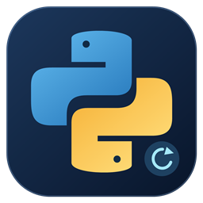

# Windows 环境管家

用中文图形界面管理 Java 和 Python 的多个版本，为每道 CTF 题目保存独立的运行环境，无需记切换命令。

 

## 两个独立程序

| 程序 | 功能 |
| --- | --- |
| **JavaManager** | 切换默认 JDK、打开独立终端、固定题目完整构建号及核心文件指纹、用指定版本运行 JAR 并查看日志 |
| **PythonManager** | 切换默认 Python、每题创建独立虚拟环境、安装及导出依赖、检查包冲突、用指定环境运行脚本并查看日志 |

程序是 C# Windows Forms EXE，管理界面使用 Windows 自带的 .NET Framework；运行 Java / Python 程序时仍需相应解释器。仓库不包含 JDK、JRE 或 Python 本体。

## 下载使用

从仓库的 **Releases** 下载对应 ZIP，完整解压，再双击 `JavaManager.exe` 或 `PythonManager.exe`。Python 版本需要保留 ZIP 中的 `tools` 目录。

也可以用 **Code → Download ZIP** 下载源码仓库，直接运行各子目录里的 EXE。

当前版本按以下 Windows 64 位目录布局设计：

```text
D:\code\Java\
  JDK8u65\
  JDK8u181\
  JDK8u451\
  JDK17\
  JDK21\
  JavaManager\JavaManager.exe

D:\code\Python\
  Python2\python.exe
  Python39\python.exe
  Python314\python.exe
  PythonManager\PythonManager.exe
```

**目录限制：** 这版仍包含 `D:\code\Java` / `D:\code\Python` 固定根目录。Java 扫描 `JDK*` 子目录；Python 另可通过“添加 Python”选择解释器，也读取标准 PythonCore 注册表。迁移到其他盘符前应修改核心源码中的根目录常量并重新编译。仓库不会自动安装解释器或自动套用某个默认版本。

## 日常使用

选择版本后，点击“设为日常默认”，新启动的终端生效；已有终端、IDE 和运行中的程序保持其原环境。点击“独立 CMD / PowerShell”，可以同时打开使用不同版本的终端。

### Java 题目

选择题目文件夹及所需 JDK → 保存题目绑定 → 打开题目终端或用绑定版本运行 JAR。

题目中生成 `.java-version` 和 `.java-runtime.json`，记录完整构建号、厂商、绝对目录和核心文件指纹。验证不一致时会提示，不会自动降级或换版本。首次清理系统中的 Oracle Java 路径需要 Windows 管理员确认。

### Python 题目

选择题目文件夹及基础 Python → 创建题目环境 → 安装依赖 → 打开题目终端或运行脚本。

每题生成 `.ctf-venv`、`.python-version`、`.python-environment.json` 和 `python-environment.lock.txt`。成功安装依赖后会更新记录；在外部修改依赖时，需检查后点击“更新依赖记录”。环境中的包与日常 Python、其他题目隔离。

Python 2.7 环境创建使用 `tools/legacy-host` 中的 virtualenv 20.15.1，由 `D:\code\Python\Python39\python.exe` 启动管理组件，题目实际解释器仍为 Python 2.7；请保留该 Python 3.9 安装。组件从 PyPI 下载并校验 SHA-256，详见 [组件来源](PythonManager/tools/component-sources.json) 和 [第三方说明](THIRD_PARTY_NOTICES.md)。

## 编译

需要 Windows 64 位和系统 .NET Framework C# 编译器，无需 Visual Studio 或联网恢复依赖。在仓库根目录用 PowerShell 执行：

```powershell
.\build.ps1
```

也可分别执行 `JavaManager\source\build.ps1` 和 `PythonManager\source\build.ps1`。图标与源码均已包含。构建只生成 EXE，不修改环境变量，不创建题目环境。

用 `package.ps1` 生成两个可分发 ZIP 和 SHA-256 清单，输出到未跟踪的 `artifacts/`。

## 说明与验证

- [Java 使用说明](JavaManager/使用说明.md)
- [Python 使用说明](PythonManager/使用说明.md)
- [验证范围和限制](docs/VALIDATION.md)
- `tests/` 保留本机集成测试源码；测试需要预先安装指定版本，不能直接在没有解释器的机器上运行。

本仓库不包含本机环境变量备份、运行日志、最近题目记录、用户项目或登录凭据。运行后生成的 `data/` 默认被 Git 忽略。

## 使用范围

题目绑定只作用于从管家打开的终端或运行任务。IDE 的项目 SDK / Python 解释器仍需选择对应路径。Python 依赖文件是版本与来源快照，并非包含所有离线包和哈希的完整重建包；本地 wheel 或 Git 依赖的原始来源需要另外保留。

虚拟环境是依赖隔离，不是安全沙箱。CTF 的依赖库、参数、原生扩展、操作系统与外部服务仍需匹配题目要求。部分功能保留了本机目录约定，本项目当前作为这两套管家的源码及可运行版本归档。
